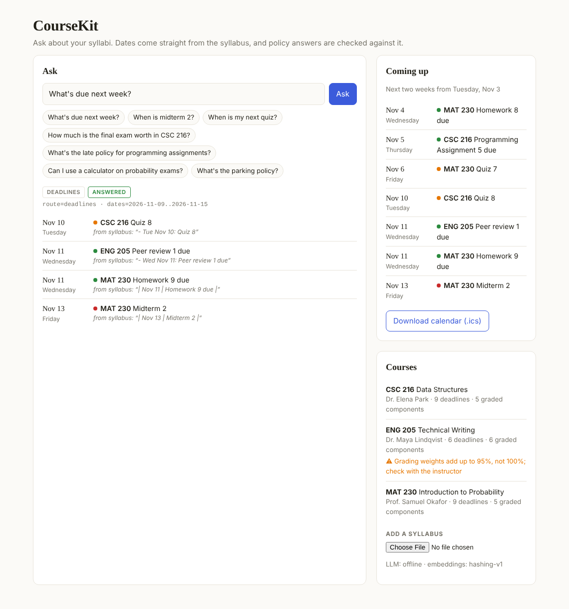
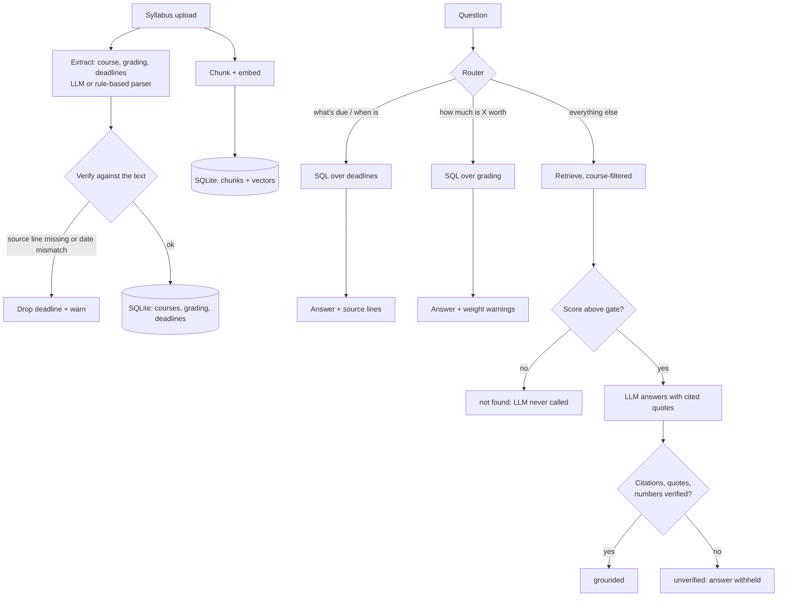

# CourseKit

A syllabus assistant. Upload your course syllabi and ask things like *"What's due next week?"*, *"How much is the final worth?"*, or *"Can I use a calculator on exams?"*. It also exports every deadline to your calendar.

The core idea: **different questions need different machinery.**

- Date questions are answered with **SQL** over deadlines extracted from the syllabi. That's exact, needs no LLM, and every result links back to the syllabus line it came from.
- Policy questions are answered with **retrieval + an LLM**, and an answer is only shown if it passes checks against the syllabus text.

> The three syllabi in `data/` are from *Northshore State University*, a fictional school created as demo data.



## Features

| | Endpoint |
|---|---|
| Upload a syllabus (`.md`, `.txt`, `.pdf`) | `POST /courses` |
| Ask a question (routed automatically) | `POST /ask` |
| Query deadlines by date range, course, type | `GET /deadlines?start=&end=&course=&kind=` |
| Download all deadlines as a calendar file | `GET /calendar.ics` |
| Courses with grading breakdowns and warnings | `GET /courses` |
| Interactive API docs | `GET /docs` |

## How it works



### 1. Extraction is verified, not trusted

Whether the LLM or the offline parser extracts the syllabus, `app/syllabus.py: verify` checks the result against the original text before anything is saved:

- every deadline must quote a **source line that actually exists** in the syllabus (catches invented deadlines)
- the deadline's date must be **a date written on that line** (catches "Nov 12" when the syllabus says Nov 13)
- each grading weight must appear in the syllabus, and the weights **should add up to 100%**
- deadlines should fall inside the term

Bad deadlines are dropped. A missing due date is safer than a wrong one. The sample ENG 205 syllabus deliberately has weights that add up to 95%; CourseKit flags it on upload and repeats the warning whenever you ask about that course's grading.

### 2. Questions are routed

`app/router.py` sends each question down one of three paths using deterministic rules, and every response includes an `explanation` of the decision and filters, e.g. `route=deadlines · dates=2026-11-09..2026-11-15 · kinds=exam`.

- *"What's due next week?"* becomes `due_date BETWEEN next Monday AND next Sunday`, across all courses.
- *"When is my next quiz?"* takes the first upcoming quiz. *"When is the final for data structures?"* detects the course from its title and keeps only titles containing "final".
- *"Can I bring notes to the final exam?"* mentions an exam but asks about a rule, so it goes to retrieval.

Similarity search is bad at date arithmetic. Routing date questions to SQL makes them exact and free.

### 3. Policy answers are grounded

Same approach as a citation-checked RAG pipeline:
1. **Retrieval gate:** if no chunk clears the similarity threshold, return "not found" without calling the LLM.
2. **Course filter:** if the question names a course, retrieval only searches that course's syllabus.
3. **Constrained prompt:** the model sees only numbered passages and must cite them with verbatim quotes.
4. **Verification:** cited passages must be ones we retrieved, quotes must appear in them, and every number in the answer must appear in a cited passage. Otherwise the answer is withheld.

## Evaluation

`evals/questions.json`: 27 questions (10 deadline, 4 grading, 9 policy, 4 the syllabi can't answer), run with `python -m evals.run_eval`. Deadline answers must match the expected set of items *exactly*.

Results in both modes:

| Metric | Offline (keyword embeddings, no LLM) | OpenAI (`gpt-4o-mini` + `text-embedding-3-small`) |
|---|---|---|
| Routing accuracy | 27/27 | 27/27 |
| Correct answers | 22/23 | 21/23 |
| Correct refusals | 4/4 | 4/4 |
| Wrong answers shown | 0 | 5 |

### Bugs the eval caught

The first run scored 20/23 answers and 2/4 refusals. Fixing these was the most useful part of the project:

- **The course name made everything look relevant.** Every chunk carries its course in its heading path, so asking *"Is there a textbook for CSC 216?"* matched every CSC 216 chunk on "CSC 216" alone. That pushed scores past the gate, and the system returned an unrelated sentence. Fix: once a course is detected and applied as a filter, strip it from the search query (`strip_course_mentions`). Both false answers became correct refusals.
- **"When is spring break?"** matched the "when" rule and listed every deadline in the next two weeks. Fix: a "when is X" question with no recognizable graded item goes to text search, where the gate correctly refuses it.
- **"Final report"** also returned the "Final report draft." Fix: titles with "draft" only match when the question says "draft".
- **Small text bugs:** plural folding turned "classes" into "classe", and the sentence splitter cut "Dr. Park" in half.

The remaining miss, *"What happens if I **miss** a probability exam?"* vs. *"...the **missed** exam"*, is a keyword-embedding limitation. It now fails safely as "not found" rather than returning a wrong answer, and semantic embeddings should fix it. Each fix has a regression test.

## Run it

```bash
python -m venv .venv && source .venv/bin/activate   # Windows: .venv\Scripts\activate
pip install -r requirements.txt
cp .env.example .env    # optional: Azure OpenAI or OpenAI keys
uvicorn app.main:app --reload
```

Open http://127.0.0.1:8000. The sample syllabi load on first start. The sample dates are in Fall 2026, so set `COURSEKIT_TODAY=2026-11-03` in `.env` to see the demo as intended.

With no keys, everything runs offline: rule-based extraction, keyword embeddings, extractive answers. With keys, `LLM_PROVIDER=auto` uses Azure, then OpenAI, for both extraction and answers.

```bash
pytest                      # 42 tests; LLM calls use a fake client, no network
python -m evals.run_eval
```

## Project layout

```
app/
  main.py             FastAPI routes; seeds sample syllabi on first start
  syllabus.py         extraction (LLM or rule-based) + verification against the text
  router.py           question routing, date-range parsing, course detection
  answer.py           SQL answers for deadlines/grading, verified RAG for policies
  grounding.py        citation / quote / number checks for LLM answers
  store.py            SQLite: structured tables + chunk vectors
  calendar_export.py  RFC 5545 .ics export
  ingest.py           file -> text -> heading-aware chunks
  embeddings.py       OpenAI/Azure embeddings, or offline hashing embeddings
  llm.py              chat wrapper returning validated Pydantic objects
  static/index.html   single-page UI, no build step
evals/                question set + eval script
tests/                pytest suite
```

## Next steps

- OCR for scanned syllabi (Tesseract); PDFs without a text layer are currently rejected with a clear error
- Use the LLM as a fallback router when the rules aren't confident
- Recurring items ("quizzes every Friday") expanded into individual dates
- A Google Calendar subscription URL instead of a one-time download
